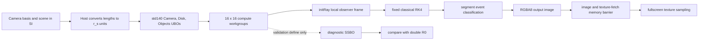

# B1 phase 4: corrected fixed-step GPU implementation

## Problem and source changes

The development compute shader originally used float SI state, an unverified spherical RHS, a null-inconsistent camera initialization, Forward Euler under an `rk4Step()` name, and endpoint-only event tests. B1 changes the development-only `src/black_hole.cpp` and `shaders/geodesic.comp`; the `src/baseline/` tree is untouched. The equation and camera frame follow [the model derivation](02_schwarzschild_model.md).

## State, initialization, integration

Each ray stores dimensionless `r/r_s`, orbital-plane angle `psi`, radial affine derivative, conserved `E=1`, signed plane angular momentum `L`, and a fixed 3D radial/tangent basis. The host divides camera positions, object centers, and radii by the computed Schwarzschild radius. Scene and horizon positions therefore use the same scale. Screen-space directions use camera right/up/forward as a local static-observer orthonormal frame. `initRay()` decomposes the unit spatial direction into radial/transverse parts and sets `dr/dsigma=n_r`, `L=r |n_perp|/sqrt(f)` for the chosen positive plane orientation, so the initial null constraint is satisfied.

`geodesicRHS()` evaluates the reduced null-constrained equations, `psiDot=L/r^2` and `rDDot=L^2/r^3 (1-3 r_s/(2r))`. `rk4Step()` computes classical RK4 stages `k1` through `k4` at the unchanged `0.01` affine step; no adaptive control is present. Both functions use dimensionless float state in GLSL, while R0 uses double. The fixed compute image is 200 x 150 (30,000 rays), workgroups are 16 x 16, and each ray terminates at an event, escape radius 100, invalid state, or 60,000 steps.

## Event handling and data flow

After each RK4 step, the shader reconstructs old/new Cartesian points and computes the first segment intersection among the horizon sphere (`r=1`), disk plane/annulus (`2.2 <= r <= 5.2` in the x-z disk plane), object spheres, and outward escape sphere (`r=100`). The event with the smallest segment fraction wins. The result is interpolated to that location for rendering. Invalid state is magenta, maximum-step termination orange, horizon black, disk and object events colored, and an escaped ray transparent; numerical failure is not shown as escape.



The 80-byte camera UBO contains five vec4 records; the 32-byte disk UBO contains two vec4 records; the 528-byte objects UBO contains one ivec4 plus two 16-element vec4 arrays. C++ static assertions lock these sizes. `mass[16]` was removed from the B1 shader because it was unused and its old tightly packed host array contradicted `std140` scalar-array stride. The host dispatch follows image writes with `GL_SHADER_IMAGE_ACCESS_BARRIER_BIT | GL_TEXTURE_FETCH_BARRIER_BIT` before drawing the sampled texture.

The diagnostic SSBO is compiled only when `B1_DIAGNOSTICS` is prepended by `BlackHoleB1GpuValidation`; the production shader has no diagnostic buffer writes. The test dispatch uses the same B1 shader source and compares one radial and one general 3D-oriented trajectory against R0, then compares horizon, disk, object, and escape classifications and event locations. A test-only `B1_MAXIMUM_STEPS` shader define also exercises maximum-step termination after one step, and a zero-radius camera input verifies that a non-finite ray gets the invalid-state marker rather than the escape result.

## Complexity, memory, hardware, limitations

For `P` rays, `S` steps per ray and `M` scene objects, worst-case compute work is `O(P S (M+1))`: four RHS evaluations per attempted RK4 step and up to `M` sphere tests after the step. Per-ray state is constant-size shader local storage; output memory is one RGBA8 texel per pixel. The diagnostic run allocates about 0.92 MiB for 60,001 vec4 samples for one ray; it is excluded from the application target.

The GPU arithmetic is GLSL `float` on the tested Intel UHD Graphics driver; R0 is C++ `double`. Float roundoff accumulates with path length, and event surfaces are located on a straight segment between RK4 endpoints. The tested hardware/software details and observed errors are in `05_numerical_validation.md`. Schwarzschild coordinates are used outside the horizon only; the reduced radial equation remains regular to locate the horizon event, but no interior physical trajectory is continued. The disk and objects are render/event geometry and do not alter the metric.

## Build and runtime verification

```powershell
cmake --build build/msvc-vs2026 --config Release --target BlackHole3D BlackHole3D_B1 BlackHole3D_baseline
ctest --test-dir build/msvc-vs2026 -C Release --output-on-failure
```

Run each target from its own staged executable directory so relative shader loading resolves. A successful compile or shader link does not by itself prove image correctness; the numerical GPU comparisons and their tolerances are reported separately. A screenshot-based visual comparison has not been used as numerical evidence.
